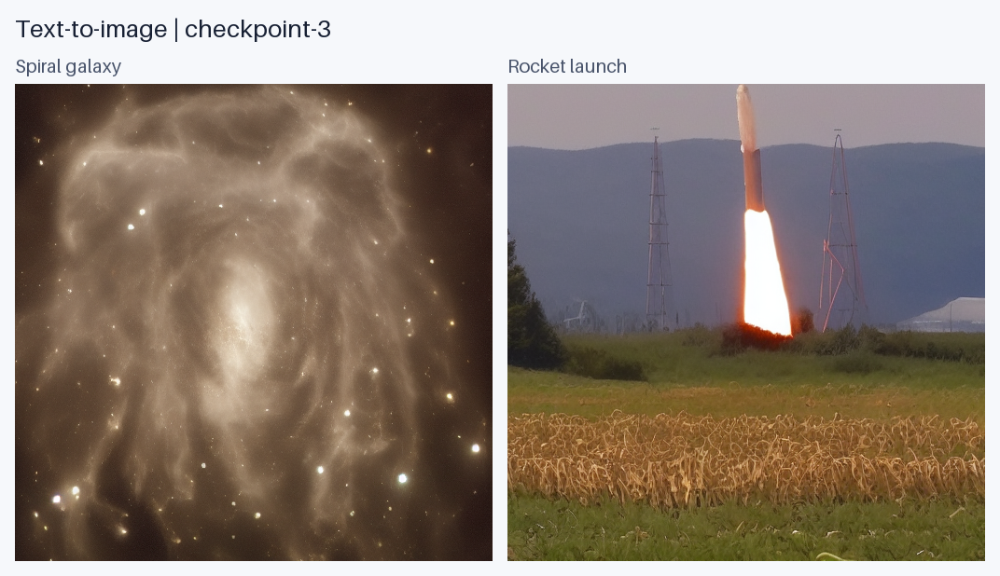
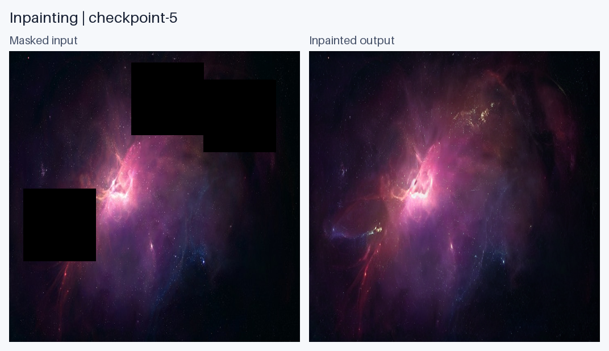

# Astronomy Diffusion

Astronomy image generation and inpainting with Stable Diffusion and LoRA, using NASA Astronomy Picture of the Day (APOD) images.

The project includes saved LoRA adapters, a Python inference package, command-line tools, and the original training notebooks.

## Text-to-image

Generate 512x512 astronomy images from text prompts with Stable Diffusion 1.5. These samples use the included Task1 `checkpoint-3` adapter.



## Inpainting

Restore masked image regions with Stable Diffusion Inpainting. This example uses the included Task2 `checkpoint-5` adapter.



## Installation

Use Python 3.10. Install PyTorch for your device first. The tested NVIDIA GPU setup uses CUDA 12.6:

```sh
python -m pip install torch==2.8.0 --index-url https://download.pytorch.org/whl/cu126
python -m pip install -e .
```

For notebook support:

```sh
python -m pip install -e ".[notebooks]"
```

Base models are downloaded from Hugging Face on the first run. The dataset is not required for inference.

## Usage

### Generate an image

```sh
astronomy-generate --prompt "A beautiful spiral galaxy with bright stars and cosmic dust" --checkpoint checkpoint-3 --seed 42 --steps 50 --output outputs/galaxy.png
```

### Restore an image

Run the included example, or supply your own image and a mask with the same dimensions. White mask pixels mark regions to regenerate.

```sh
astronomy-inpaint --image assets/inpainting/input.png --mask assets/inpainting/mask.png --checkpoint checkpoint-5 --seed 42 --steps 50 --output outputs/inpainted.png
```

Both commands select CUDA automatically when available. Detailed usage: [text-to-image](Task1/INFERENCE.md) and [inpainting](Task2/INFERENCE.md).

## Repository

| Path | Contents |
| --- | --- |
| `src/astronomy_diffusion/` | Reusable inference code and command-line tools |
| `Task1/` | Text-to-image notebook and LoRA adapters |
| `Task2/` | Inpainting notebook, LoRA adapters, and sample images |
| `assets/` | Project previews and the inpainting example |

Built with Python, PyTorch, Diffusers, Transformers, and PEFT.
